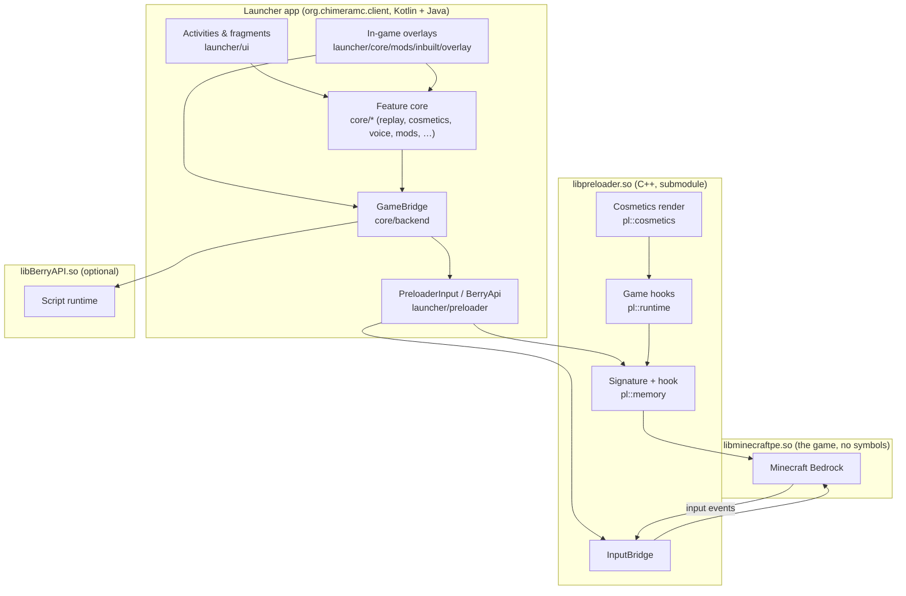

# Architecture

GlowberryClient is three cooperating pieces: the **launcher app**, the **preloader** native
runtime, and an optional **script runtime** (BerryAPI). This page is the one diagram and the
"who calls whom" that the plan asks for (item 321).

## The three pieces

## Who calls whom

| Caller | Callee | Why |
| --- | --- | --- |
| Launcher feature (overlay, mod) | `GameBridge` | Every capability (send key, look delta, FPS) is a `GameBackend` call, so a missing backend degrades quietly instead of crashing. |
| `GameBridge` | `LauncherGameBackend` | The in-app implementation, which forwards to the preloader's input bridge. |
| `GameBridge` | BerryAPI | The script runtime can implement the same interface; `GameBridge.register` swaps it in live. |
| Launcher (`ModManager`) | `System.loadLibrary("preloader")` | Maps the preloader into the game's own process, so a hook runs in the address space of `libminecraftpe.so`. |
| Preloader | game binary | Only through a resolved signature or vtable slot: game classes export no symbols. |
| Game | preloader `InputBridge` | Touch, key, text and mouse events are forwarded to registered callbacks. |

## Key seams

- **`GameBackend` / `GameBridge`** (`core/backend`) — the client's input and FPS seam. With no
  backend registered every call is a quiet no-op returning `false`, so the launcher still starts
  and the overlays degrade quietly (item 502).
- **`PreloaderInput`** (`launcher/preloader`) — the JNI surface to the preloader: signature rules,
  input injection, render geometry, cosmetic frames, diagnostics.
- **`BerryApi`** (`launcher/preloader`) — a thin, fail-closed read of the bundled BerryAPI runtime.
  When the library is missing every capability is clear, so a dependent feature is greyed out
  rather than appearing to work.
- **Pure-rule extraction.** Rules that must be unit-tested live in Android-free classes
  (`ApiLevels`, `DisplayModePreference`, `LauncherTab`, `NavLayoutMode`, `ModMenuNavigation`,
  `CapeAnimationCurve`, …); the Android type only paints or applies what the pure class returns.
  This is why a JVM test can pin behaviour that a device would otherwise be needed to see.

## Where a feature lives

| Concern | Package |
| --- | --- |
| Launch flow, versions, storage | `launcher.core.minecraft`, `launcher.core.versions` |
| In-game overlays and the Mod Menu | `launcher.core.mods.inbuilt.overlay` |
| Mod loading, AntEgg packaging, JavaBridge | `launcher.core.mods`, `core.antegg`, `core.javabridge` |
| Cosmetics (catalogue, preview, native feed) | `core.cosmetics`, `launcher.core.mods.inbuilt.overlay` |
| Replay | `core.replay` |
| Voice and cosmetic sync | `core.voice`, `core.cosmetics` |
| Native bridge and compat | `core.jni`, `util` |
